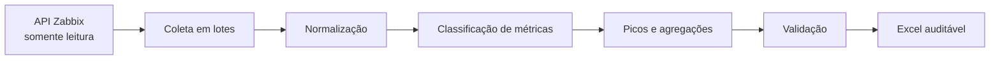

# Zabbix Reporting Pipeline

[](https://github.com/CelsoKaiqueSil/zabbix-reporting-pipeline/actions/workflows/ci.yml)
[](pyproject.toml)
[](src/zabbix_reporting/pipeline.py)
[](src/zabbix_reporting/pipeline.py)
[](src/zabbix_reporting/readonly.py)
[](data/sample_metrics.csv)

Pipeline demonstrativo para transformar métricas de monitoramento em relatórios
Excel rastreáveis. A edição pública utiliza somente dados sintéticos e mantém uma
lista explícita de métodos permitidos para impedir chamadas de escrita na API.

## O que o projeto demonstra

- classificação de CPU, memória e tráfego;
- tratamento especial de nomes ambíguos, como `Processor: Memory utilization`;
- cálculo de média, máximo, primeira data/hora do pico e recorrência do pico;
- processamento reproduzível e geração de planilhas por camada;
- indicação de ausência de dados sem substituir valores ausentes por zero;
- bloqueio de métodos de escrita do Zabbix;
- testes automatizados para regras críticas.

## Arquitetura



O exemplo público começa em um CSV que representa a resposta já coletada da API.
Assim, qualquer pessoa pode executar o pipeline sem acesso a um ambiente Zabbix.

## Executar

```bash
python -m venv .venv
python -m pip install -e ".[dev]"
zabbix-report --input data/sample_metrics.csv --output output/zabbix_report.xlsx
pytest -q
```

O arquivo gerado contém as páginas `Resumo`, `Picos`, `CPU`, `Memória`,
`Tráfego` e `Controle`.

## Segurança

- `.env` e arquivos de saída não são versionados;
- o token do exemplo é apenas um placeholder;
- métodos como `host.create`, `item.update` e `event.acknowledge` são bloqueados;
- nomes de clientes, hosts, URLs e métricas do exemplo são fictícios;
- nenhum código de implantação ou configuração corporativa é publicado.

## Contexto profissional

O estudo de caso representa uma automação aplicada a relatórios recorrentes de
monitoramento, com foco em qualidade, rastreabilidade, leitura segura da API e
redução de consolidações manuais.
