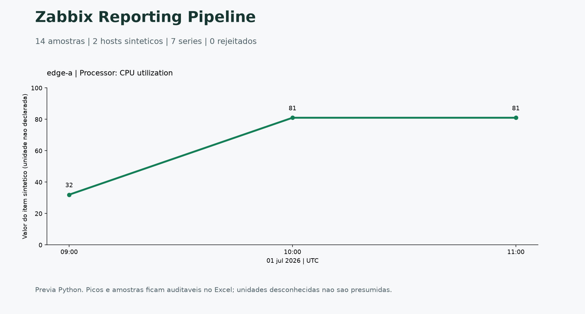
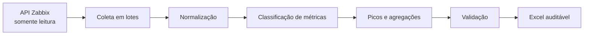

# Zabbix Reporting Pipeline

[](https://github.com/CelsoKaiqueSil/zabbix-reporting-pipeline/actions/workflows/ci.yml)

**Métricas de monitoramento com contexto e rastreabilidade.** Classificação de
CPU, memória e tráfego, análise de picos e geração de relatórios Excel.

[Baixar Excel de exemplo](docs/examples/zabbix_report.xlsx) ·
[Executar](#executar) ·
[Proteção somente leitura](src/zabbix_reporting/readonly.py) ·
[Limites da demonstração](#limites-da-demonstracao)

## Resultado em uma leitura



<sub>Prévia Python, não captura do Zabbix. Entrada: 14 amostras, 2 hosts e 7 séries. CPU de edge-a: pico 81 às 10:00 UTC, com duas ocorrências. A unidade não é presumida.</sub>

A demonstração começa em CSV e funciona sem credenciais. A coluna opcional
`unit` declara a unidade; quando ausente, permanece `unspecified`.

## O que o projeto demonstra

- classificação de CPU, memória e tráfego;
- tratamento especial de nomes ambíguos, como `Processor: Memory utilization`;
- cálculo de média, máximo, primeira data/hora do pico e recorrência do pico;
- processamento reproduzível e geração de planilhas por camada;
- indicação de ausência de dados sem substituir valores ausentes por zero;
- bloqueio de métodos de escrita do Zabbix;
- testes automatizados para regras críticas.

## Arquitetura



O exemplo público começa em um CSV que representa a resposta já coletada da API.
Assim, qualquer pessoa pode executar o pipeline sem acesso a um ambiente Zabbix.

## Executar

```bash
python -m venv .venv
source .venv/bin/activate  # Linux/macOS
python -m pip install -e ".[dev]"
zabbix-report --input data/sample_metrics.csv --output output/zabbix_report.xlsx
pytest -q
```

O arquivo gerado contém as páginas `Resumo`, `Picos`, `CPU`, `Memória`,
`Tráfego`, `Controle` e `Rejeitados`.

No Windows PowerShell: `.\.venv\Scripts\Activate.ps1` em lugar de `source`.
Sem ativacao: `.\.venv\Scripts\python.exe -m zabbix_reporting.pipeline`.
Para testar, use o mesmo Python com `-m pytest`; nao mude politicas globais.
`python scripts/validate_exports.py` confere o XLSX e `python scripts/preview.py`
regenera a imagem. Entrada vazia ainda gera controle e abas com cabecalho.

## Limites da demonstracao

A CLI comeca no CSV, nao executa uma coleta real. A allowlist e uma protecao de
integracao, nao evidencia de acesso a Zabbix. Datas e numeros invalidos ou infinitos
sao rejeitados com motivo; nenhuma credencial e necessaria. Medias nao sao ponderadas
por intervalo de amostragem; series irregulares exigem outro metodo antes de uso real.

## Segurança

- `.env` e arquivos de saída não são versionados;
- o token do exemplo é apenas um placeholder;
- métodos como `host.create`, `item.update` e `event.acknowledge` são bloqueados;
- nomes de clientes, hosts, URLs e métricas do exemplo são fictícios;
- nenhum código de implantação ou configuração corporativa é publicado.

## Contexto profissional

O estudo de caso representa uma automação aplicada a relatórios recorrentes de
monitoramento, com foco em qualidade, rastreabilidade, leitura segura da API e
redução de consolidações manuais.
